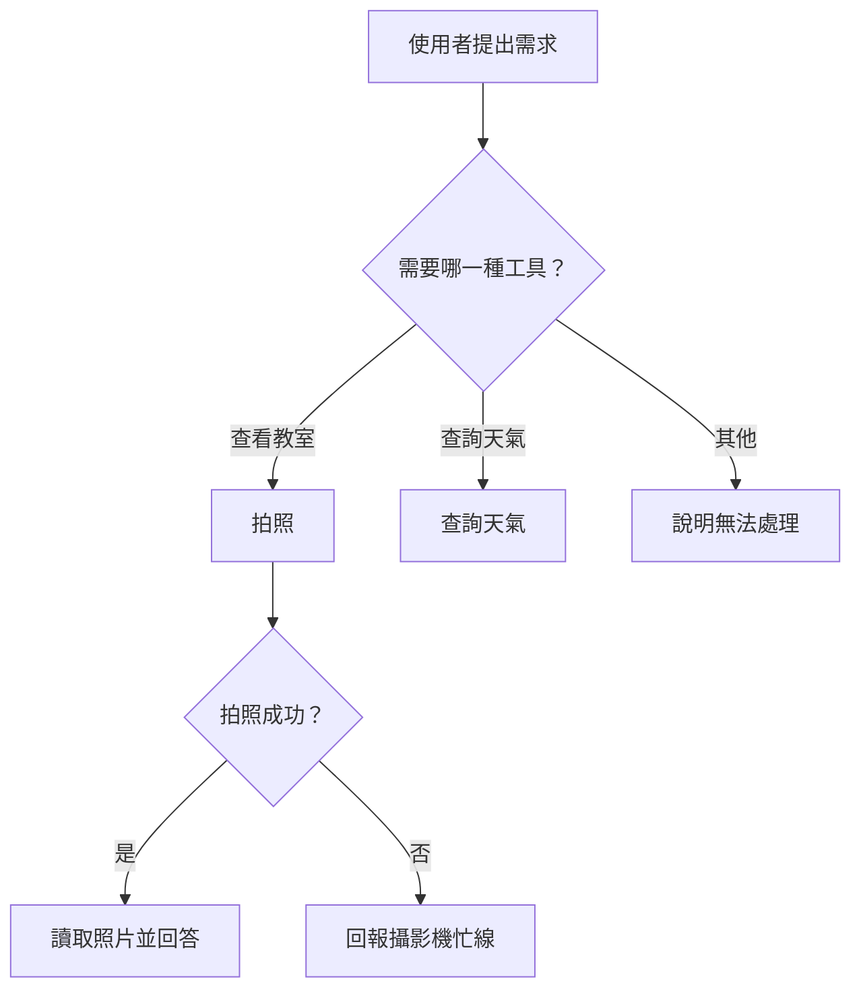
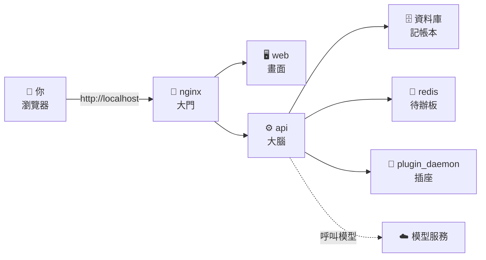
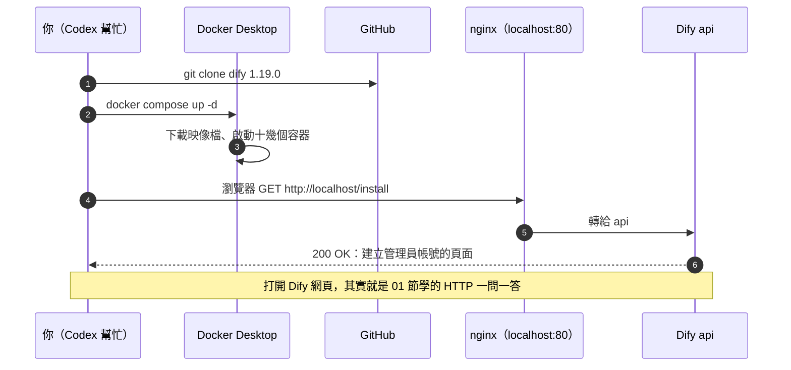

# 13｜在自己的電腦架一台 Dify：AI 工廠開張

## 情境

> 在 03 節，我們透過 MCP 把教室工具箱交給 Codex，它可以自行拍照、讀取照片並查詢天氣。
> 然而，工具越多，Agent 要處理的事情就越複雜：應該先拍照還是先讀照片？拍照失敗時要怎麼處理？使用者提出的問題超出工具範圍時，又該如何回應？
> 如果每一步都交由 AI 臨場判斷，結果未必穩定，事後也難以追查它為何如此決定。
> 因此，我們需要一張**樹狀的流程圖**，事先規劃「遇到什麼情況、走哪一條路徑」，讓 Agent 依照設計好的路線執行任務。
> 本節的目標，是在自己的電腦上架設 **Dify**，作為繪製與執行這張流程圖的平台。



> 這張樹狀圖會在 05、06 節逐步完成；本節先把畫圖的工具準備好。

## 一張圖看懂



**Dify 並非單一程式，而是由十幾個容器協同運作的服務組合：Docker 提供執行環境，`docker compose` 依設定檔一次啟動所有容器。**

## 通訊圖



## 觀念解釋

### 為什麼要用 Docker

| 沒有 Docker | 有 Docker |
| --- | --- |
| 自己裝資料庫、redis、Python、Node.js…… | 一行開工單，全部照版本裝好 |
| 「在我電腦可以跑」 | 大家跑的是同一份映像檔 |
| 裝壞了很難清乾淨 | 刪掉容器就回到原狀 |

| 名詞 | 比喻 | 這節的例子 |
| --- | --- | --- |
| **映像檔（image）** | 機器的設計圖 | `langgenius/dify-api` |
| **容器（container）** | 照設計圖蓋好、正在運轉的機器 | `docker-api-1` |
| **docker compose** | 開工單：一次開好幾台機器 | `docker-compose.yaml` |
| **WSL 2** | Windows 裡面的一台小 Linux | Docker Desktop 跑在它上面 |

### 打開 Dify，其實是在用 HTTP

| 01 節學的 | 這節裡的樣子 |
| --- | --- |
| 網址 | `http://localhost/install`（`localhost` 就是「我自己這台電腦」） |
| 埠號（port） | 預設 `80`，被別的程式佔走就改成 `8080` 之類 |
| 狀態碼 | 打得開是 `200`；`502 Bad Gateway` 代表大門開了，但後面的機器還沒醒 |

### Windows 會遇到的關卡

| 卡在哪 | 你會看到 | 怎麼辦 |
| --- | --- | --- |
| PowerShell 擋指令碼 | `因為這個系統上已停用指令碼執行`，`codex` 或 `npm` 打不開 | 見下方「PowerShell 小提醒」 |
| 沒有 WSL 2 | Docker Desktop 說需要 WSL | 用**系統管理員** PowerShell 跑 `wsl --install`，重開機 |
| Docker 沒開 | `cannot connect to the Docker daemon` | 先打開 Docker Desktop，等左下角變綠色 |
| 80 埠被佔 | `port is already allocated` | 在 `.env` 加一行 `EXPOSE_NGINX_PORT=8080`，改用 `http://localhost:8080` |
| 剛啟動就打開 | `502 Bad Gateway` | 機器還在開機，等 1～2 分鐘再重新整理 |
| 檔案放在 `C:\` | 很慢、權限怪怪的 | 官方建議：程式碼放在 WSL 的 Linux 資料夾（例如 `~/dify`） |

> **PowerShell 小提醒**：Windows 預設不讓 PowerShell 執行 `.ps1` 指令碼，所以透過 npm 安裝的 `codex` 可能打不開。
> 用**一般（不是系統管理員）**的 PowerShell 執行，只改你自己這個帳號：
>
> ```powershell
> Set-ExecutionPolicy -Scope CurrentUser -ExecutionPolicy RemoteSigned
> ```
>
> 問你要不要變更，輸入 `Y`。不要改成 `Unrestricted` 或 `Bypass`。
> 用系統管理員視窗改 `CurrentUser`，改到的可能是管理員帳號，不是你平常用的帳號。

### 你要決定的三件事

| 問題 | 這節的答案 |
| --- | --- |
| 裝哪一版？ | `1.19.0`（固定版本，大家畫面才會一樣） |
| 裝在哪裡？ | WSL 裡的 `~/dify` |
| 模型從哪來？ | 老師提供的模型 API key（**不要貼到聊天室或 Discord**，只貼進 Dify 的設定頁） |

## Workshop：讓 Dify 開工

### 題目

你只會拿到三樣東西：

| 給你的 | 內容 |
| --- | --- |
| 官方安裝說明 | <https://docs.dify.ai/en/self-host/deploy/quick-start/docker-compose> |
| 版本 | `1.19.0` |
| 模型 API key | 老師課堂上發 |

其他的（要裝什麼、指令怎麼打、錯誤怎麼解）都請 Codex 帶你做。**Codex 給的每一行指令，先請它解釋這行在做什麼，再按執行。**

| 關卡 | 請 Codex 做 |
| --- | --- |
| 1 體檢 | 檢查這台電腦有沒有 WSL 2、Docker Desktop、`docker compose`，版本多少；缺什麼就帶你裝 |
| 2 開工 | 照官方說明，在 WSL 裡把 Dify `1.19.0` 下載下來、設定好 `.env`、用 `docker compose` 啟動 |
| 3 點名 | 列出正在跑的容器，告訴你哪些是 `Up`／`healthy`，哪一個是 `Exited (0)`、為什麼那是正常的 |
| 4 開門 | 用瀏覽器打開 Dify，建立管理員帳號並登入 |
| 5 接模型 | 在 Dify 的設定頁加入老師給的模型，在「探索」或新建一個聊天機器人問它一句話 |
| 加分 | 請 Codex 解釋：為什麼資料庫、redis 都沒有開 port 到外面？如果把 Dify 開到公網，要先改哪些密碼？ |

> 下載映像檔有好幾 GB，全班同時下載會很慢。**課前先完成關卡 1、2 的同學，上課就從關卡 3 開始。**
> 卡住超過 10 分鐘，先舉手，改用老師的備援 Dify 繼續做 14、15 節，回家再補裝。

### 驗收標準

- [ ] `docker compose ps` 看得到 Dify 的容器在跑
- [ ] 瀏覽器打得開自己的 Dify，並且已登入
- [ ] Dify 裡的模型回答了你的一句話
- [ ] 把結果記進前三節的同一份 CSV（新增一列：13、Dify 網址、模型名稱、是否成功）

## 預期輸出

`docker compose ps` 大概長這樣（實際容器名稱與數量以你的畫面為準）：

```text
NAME                    STATUS
docker-api-1            Up (healthy)
docker-web-1            Up
docker-nginx-1          Up
docker-db_postgres-1    Up (healthy)
docker-redis-1          Up (healthy)
docker-init_permissions-1   Exited (0)
...
```

> 截圖待補：Dify 登入後的首頁。

## 觀念驗收

1. 打開 `http://localhost/install` 時，你的瀏覽器在做什麼？
   (A) 連到 Dify 官網　(B) 用 HTTP 問自己電腦上的 nginx　(C) 用 MQTT 訂閱　(D) 呼叫 MCP 工具
2. Docker 的「映像檔」和「容器」，哪個比較像正在運轉的機器？
   (A) 映像檔　(B) 容器　(C) 兩個一樣　(D) 都不是
3. 打開網頁看到 `502 Bad Gateway`，最可能的原因是？
   (A) 你打錯網址　(B) 你沒有權限　(C) 大門 nginx 開了，但後面的 api 還沒準備好　(D) 模型 API key 錯了
4. `port is already allocated` 怎麼解？
   (A) 重灌 Windows　(B) 把 Dify 改到另一個埠號，例如 8080　(C) 關掉防毒　(D) 換一台電腦
5. 老師發的模型 API key 應該放在哪？
   (A) Discord 班群　(B) CSV 裡　(C) 只貼進自己 Dify 的模型設定頁　(D) 貼給 Codex 請它記住
6. PowerShell 說「已停用指令碼執行」，比較安全的做法是？
   (A) 用一般 PowerShell，只對自己帳號設 `RemoteSigned`　(B) 全電腦改 `Unrestricted`　(C) 關掉 Windows Defender　(D) 每次都用系統管理員開

:::spoiler 答案
1. B　2. B　3. C　4. B　5. C　6. A
:::
