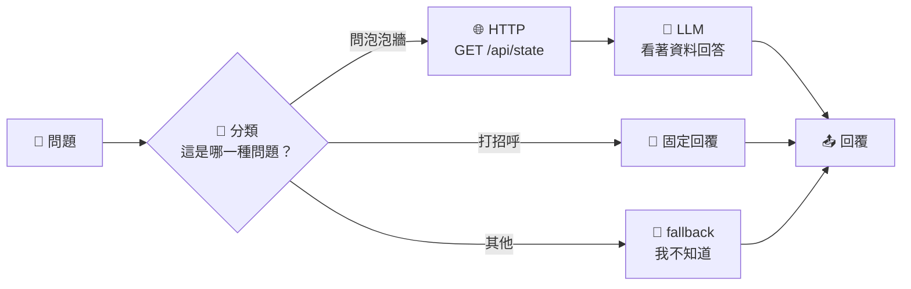
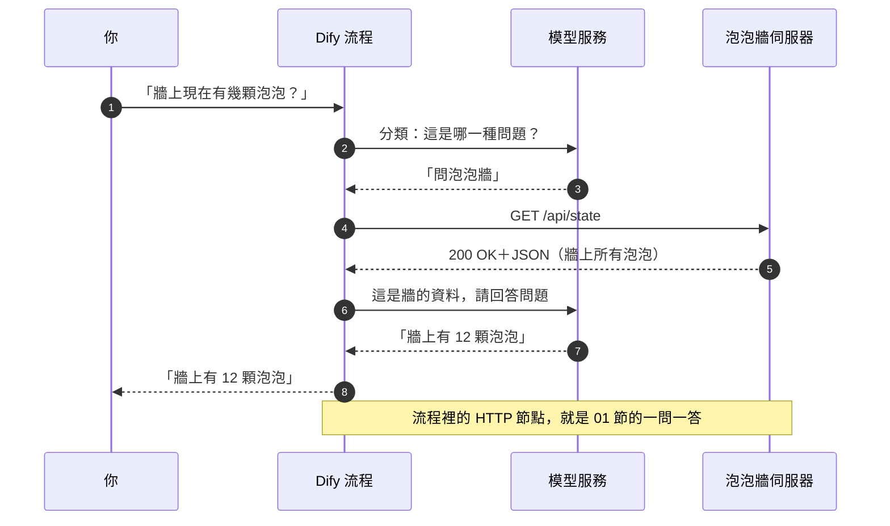

# 14｜畫一張流程圖：讓 AI 照你的路線走

## 情境

> 泡泡牆上越貼越多，同學在 Discord 問小幫手：「牆上現在有幾顆泡泡？」
> 小幫手只會聊天，它沒看過牆，就隨便回了一個數字。
> 這次不讓 AI 自己猜。你畫一張流程圖：**問牆的事，先去查牆；其他的，老實說不知道。**

## 一張圖看懂

**像捷運路線圖：每一站做一件事，叉路由你決定。乘客（資料）只能沿著你畫的線走，不會自己跳車。**

## 通訊圖

## 觀念解釋

### 03 節 vs 這節：誰決定下一步？

| | 03 節（Codex＋MCP） | 這節（Dify 流程） |
| --- | --- | --- |
| 誰決定按哪顆按鈕 | AI 自己看工具清單決定 | **你**事先畫好路線 |
| 每次走法 | 可能不一樣 | 同樣的分類，走同樣的路 |
| 出錯時 | 不容易知道它為什麼這樣選 | 每一站的輸入、輸出都看得到 |
| 適合 | 開放、臨時的任務 | 要重複、要穩定的任務 |

### 流程圖就是一台「狀態機」

狀態機聽起來很難，其實你天天在用：

| 生活例子 | 狀態（站） | 什麼事讓它換站 |
| --- | --- | --- |
| 紅綠燈 | 綠 → 黃 → 紅 | 時間到 |
| 販賣機 | 等投幣 → 選飲料 → 出貨 | 投幣、按按鈕 |
| 這節的小幫手 | 分類 → 查牆 → 回答 | 分類結果、HTTP 有沒有成功 |

**每一站只做一件事；換站的條件寫清楚；沒寫到的情況，就走 fallback。**

### 這節會用到的節點

| 節點 | 像什麼 | 做什麼 |
| --- | --- | --- |
| **開始（使用者輸入）** | 進站閘門 | 收下使用者的問題 |
| **問題分類器** | 轉轍器 | 請模型判斷問題屬於哪一類，決定走哪條線 |
| **HTTP 請求** | 跑腿 | 照 01 節學的方法、網址去問伺服器 |
| **條件分支（IF/ELSE）** | 檢查站 | 看狀態碼是不是 200，不是就改走另一條路 |
| **LLM** | 解說員 | 只根據前一站給的資料回答 |
| **直接回覆** | 出站閘門 | 把答案交給使用者 |

### 模型也可以混著用

| 站 | 工作難度 | 可以選 |
| --- | --- | --- |
| 分類 | 簡單：三選一 | 便宜、快的小模型 |
| 回答 | 要讀 JSON、算數量 | 比較強的模型 |

一張流程圖裡，**每一個 LLM 節點都能選不同的模型**。這就是混合模型最簡單的做法。

### fallback：沒畫到的路

| 情況 | 沒有 fallback | 有 fallback |
| --- | --- | --- |
| 問「明天會不會下雨」 | 模型亂編一個天氣 | 「我只會查泡泡牆」 |
| 泡泡牆伺服器掛了 | 模型假裝查到了 | 「泡泡牆暫時連不上，請稍後再試」 |

## Workshop：做一個泡泡牆小幫手

### 題目

你只會拿到一個網址：`https://bubbles.4impact.cc`（就是 01 節的泡泡牆）

在你自己的 Dify 裡，建一個 **Chatflow** 應用，畫出上面那張圖。不會的地方（節點在哪、變數怎麼選、JSON 怎麼給模型看）都請 Codex 帶你做；也可以把 Dify 畫面截圖給 Codex 看。

| 關卡 | 做什麼 |
| --- | --- |
| 1 畫線 | 建一個 Chatflow，用「問題分類器」分成三類：問泡泡牆、打招呼、其他 |
| 2 跑腿 | 「問泡泡牆」那條線接一個 HTTP 請求節點，去拿牆面資料（哪一個網址？回想 01 節，或請 Codex 去找） |
| 3 解說 | 接一個 LLM 節點，**只根據** HTTP 拿回來的資料回答「牆上有幾顆泡泡」「最新一顆寫什麼」 |
| 4 fallback | 「其他」那條線直接回覆「我只會回答泡泡牆的問題」 |
| 5 測試 | 用下面四個問題各問一次，在「執行記錄（追蹤）」看每一題走了哪一條線 |
| 加分 | 在 HTTP 後面加一個條件分支：狀態碼不是 200 就回覆「泡泡牆連不上」。把網址故意打錯一個字，看它有沒有走對 |
| 加分 | 分類器和解說員各選一個不同的模型 |

測試題：

| 問題 | 應該走哪條線 |
| --- | --- |
| 牆上現在有幾顆泡泡？ | 問泡泡牆 → HTTP → LLM |
| 嗨～ | 打招呼 |
| 明天雲林會下雨嗎？ | 其他（fallback） |
| 最新那顆泡泡是誰貼的？ | 問泡泡牆 → HTTP → LLM |

### 驗收標準

- [ ] 「牆上有幾顆泡泡」的答案，和你自己打開 `https://bubbles.4impact.cc/api/state` 數到的一樣
- [ ] 「明天雲林會下雨嗎？」走到 fallback，沒有亂編天氣
- [ ] 把四題各走哪條線，記進同一份 CSV

## 預期輸出

> 截圖待補：Dify 畫布上的完整流程圖。
>
> 截圖待補：「牆上現在有幾顆泡泡？」的執行記錄，可以看到 HTTP 節點回 200 與 JSON。

## 觀念驗收

1. 03 節和這節最大的差別是？
   (A) 這節不用網路　(B) 03 節由 AI 自己挑工具，這節由你畫好路線　(C) 這節不用模型　(D) 沒有差別
2. 「問題分類器」節點的工作是？
   (A) 去泡泡牆拿資料　(B) 判斷問題屬於哪一類，決定走哪條線　(C) 把答案存進資料庫　(D) 拍照
3. 流程裡的 HTTP 請求節點拿牆面資料，應該用哪個方法？
   (A) GET　(B) POST　(C) DELETE　(D) PUT
4. 使用者問「明天會不會下雨」，小幫手卻回了一個天氣預報。最可能缺了什麼？
   (A) 更貴的模型　(B) fallback 路線　(C) 更快的網路　(D) 更多泡泡
5. 為什麼分類和回答可以用不同的模型？
   (A) Dify 規定的　(B) 每個 LLM 節點都能各自選模型，簡單的工作用小模型就夠　(C) 一個模型只能用一次　(D) 不行，只能用同一個
6. 小幫手說「牆上有 12 顆泡泡」，你怎麼確認？
   (A) 相信它　(B) 再問一次　(C) 看執行記錄裡 HTTP 回了什麼，並自己打開牆面資料數一次　(D) 問隔壁

:::spoiler 答案
1. B　2. B　3. A　4. B　5. B　6. C
:::
