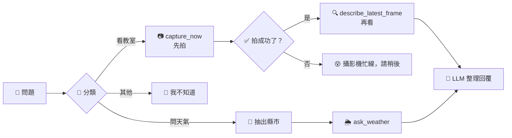
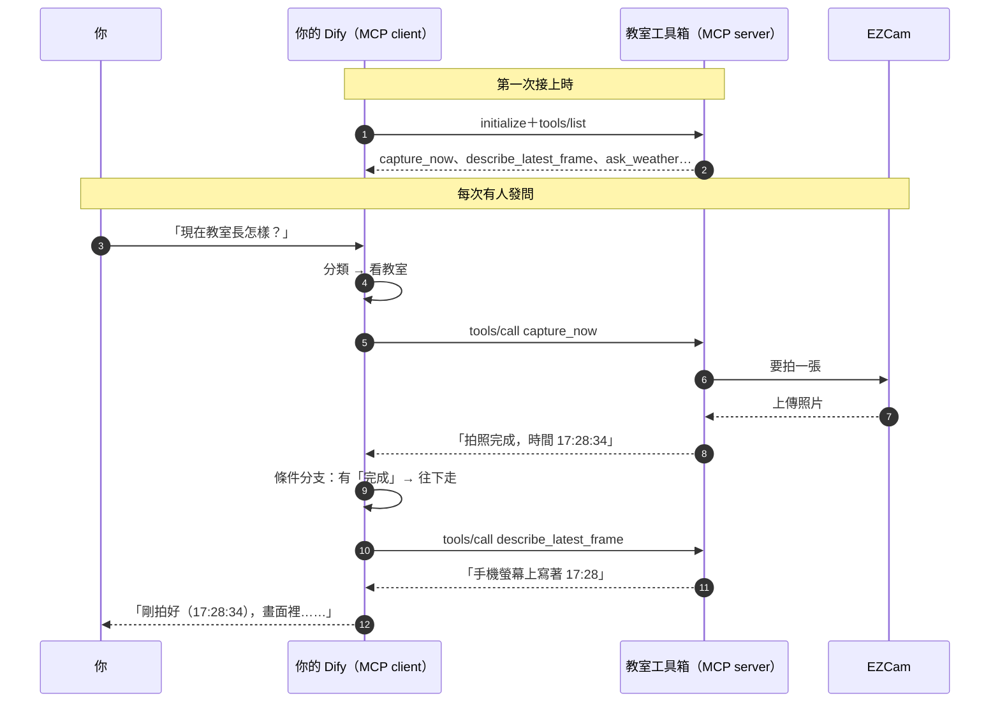

# 15｜流程按下 MCP 按鈕：讓攝影機照你的劇本走

## 情境

> 03 節，你叫 Codex 拍照。它有時先拍再看，有時沒拍就直接看舊照片，還有一次跑去查天氣。
> 這次把教室工具箱接進你的 Dify：**問攝影機，一定先拍、再看；拍失敗，就老實說失敗。**
> 工具箱還是同一個，換的是「誰決定按哪顆按鈕」。

## 一張圖看懂

**像餐廳的出餐流程：點餐後一定是「先煮 → 再擺盤 → 才上菜」，不會沒煮就上桌。工具箱裡的按鈕（MCP 工具）不變，按的順序由你的流程圖決定。**

## 通訊圖

## 觀念解釋

### 同一個工具箱，兩種用法

| | 03 節：Codex 當 client | 這節：Dify 當 client |
| --- | --- | --- |
| 誰看 `tools/list` | Codex | Dify（接上時讀一次） |
| 誰決定按哪顆 | AI 每次自己判斷 | **你**把按鈕放進流程圖 |
| 按的順序 | AI 可能跳步 | 流程圖寫死：先拍、再看 |
| 底下的通訊 | HTTP＋JSON-RPC | 一樣是 HTTP＋JSON-RPC |

**MCP 讓任何 client 都能用同一個工具箱；Dify 讓「怎麼用」變成看得見、改得了的流程圖。**

### 把流程看成狀態機

| 狀態（站） | 做什麼 | 換站條件 |
| --- | --- | --- |
| 等問題 | 收下使用者的話 | 有人發問 |
| 分類 | 判斷是看教室、問天氣、還是其他 | 分類結果 |
| 拍照 | 按 `capture_now` | 工具回了結果 |
| 檢查 | 結果裡有沒有「完成」 | 有 → 看照片；沒有 → 忙線 |
| 看照片 | 按 `describe_latest_frame` | 工具回了描述 |
| 回覆 | 整理成一句話 | 結束，回到「等問題」 |

> 狀態機的重點不是名詞，而是兩件事：**每一站只能往哪幾站走**、**出錯時退到哪一站**。

### 工具要填的參數，從哪來？

| 工具 | 參數 | 從流程的哪裡來 |
| --- | --- | --- |
| `capture_now` | `wait_seconds`（等幾秒） | 自己填固定值，例如 15 |
| `describe_latest_frame` | `question` | 直接用使用者的問題 |
| `ask_weather` | `city`（例如「雲林」） | 用「參數提取器」節點，從問題裡抽出縣市 |

03 節是 AI 自己決定參數；這節是**你決定參數從哪一站拿**。

### 實體裝置的提醒（03 節學過的，還是成立）

| 狀況 | 流程裡怎麼處理 |
| --- | --- |
| 全班同時拍，拿到同一張 | 回覆裡附上拍照時間，讓使用者自己判斷 |
| 拍照逾時 | 走「忙線」那條線，不要假裝看到了 |
| AI 看圖讀錯字 | 回覆加一句「請點開照片核對」 |

## Workshop：教室巡邏小幫手

### 題目

你只會拿到一個網址：`https://nfu-mcp.4impact.cc/mcp`（就是 03 節的教室工具箱）

在你自己的 Dify 裡：先把工具箱接進來，再建一個 **Chatflow**。怎麼加 MCP、節點怎麼接、變數怎麼選，都請 Codex 帶你做；看不懂 Dify 畫面，就截圖給 Codex。

| 關卡 | 做什麼 |
| --- | --- |
| 1 接上 | 在 Dify 的工具管理頁（Integrations／工具 → MCP）加入教室工具箱，說出它匯入了哪幾個工具 |
| 2 先拍再看 | 「看教室」那條線：`capture_now` → `describe_latest_frame` → 回覆 |
| 3 忙線 | 在兩個工具中間加一個條件分支：拍照結果沒有「完成」，就回覆「攝影機忙線，請稍後再試」 |
| 4 問天氣 | 「問天氣」那條線：參數提取器抽出縣市 → `ask_weather` → 回覆 |
| 5 fallback | 「其他」那條線回覆「我只會看教室和查天氣」 |
| 6 對照 | 同一個問題「幫我看一下教室」，分別問 Codex（03 節）和你的 Dify。比一比：誰每次都先拍？ |
| 加分 | 在 14 節的泡泡牆小幫手加一條線：「把教室現況貼上泡泡牆」。**注意：這會真的寫入**，先想清楚要不要讓使用者確認 |

測試題：

| 問題 | 應該走哪條線 |
| --- | --- |
| 幫我看一下教室，手機上寫幾點？ | 看教室：拍 → 檢查 → 看 |
| 明天雲林會下雨嗎？ | 問天氣：抽出「雲林」→ `ask_weather` |
| 日月潭還有多少水？ | 其他（這次沒放 `ask_dam`，所以走 fallback） |

> 全班共用一台攝影機，拍一張要 5～15 秒。大家同時按，可能拿到同一張照片，這是正常的。

### 驗收標準

- [ ] 執行記錄裡看得到：`capture_now` 一定在 `describe_latest_frame` 前面
- [ ] 回覆裡有拍照時間；你點開照片核對過手機上的時間
- [ ] 「日月潭還有多少水？」走到 fallback，沒有偷偷去查水庫
- [ ] 把三題各走哪條線、拍照時間，記進同一份 CSV

## 預期輸出

> 截圖待補：Dify「工具 → MCP」頁面，教室工具箱匯入的工具清單。
>
> 截圖待補：完整流程圖。
>
> 截圖待補：「幫我看一下教室」的執行記錄，兩個工具依序執行。

## 觀念驗收

1. 這節的 Workshop 裡，誰是 MCP client？
   (A) EZCam　(B) 教室工具箱　(C) 你的 Dify　(D) 泡泡牆
2. Dify 怎麼知道教室工具箱有哪些工具？
   (A) 老師手動輸入　(B) 接上時呼叫 `tools/list`　(C) 自己猜　(D) 從泡泡牆讀
3. 為什麼要在 `capture_now` 和 `describe_latest_frame` 中間加條件分支？
   (A) 讓流程比較好看　(B) 拍照失敗時不要假裝看到了，改走忙線那條線　(C) 讓拍照變快　(D) Dify 規定一定要加
4. 和 03 節相比，用 Dify 流程按 MCP 按鈕的好處是？
   (A) 不用網路　(B) 按的順序由你決定，每次都一樣，執行記錄也看得到　(C) 攝影機會變清楚　(D) 不用模型
5. 「明天雲林會下雨嗎？」裡的「雲林」，是靠哪個節點交給 `ask_weather`？
   (A) 參數提取器　(B) 直接回覆　(C) HTTP 請求　(D) 條件分支
6. 加分題的「把教室現況貼上泡泡牆」，和前面的關卡最大的不同是？
   (A) 它比較慢　(B) 它會真的改變外面的東西（寫入），要先想清楚要不要讓人確認　(C) 它不用 HTTP　(D) 沒有不同

:::spoiler 答案
1. C　2. B　3. B　4. B　5. A　6. B
:::
